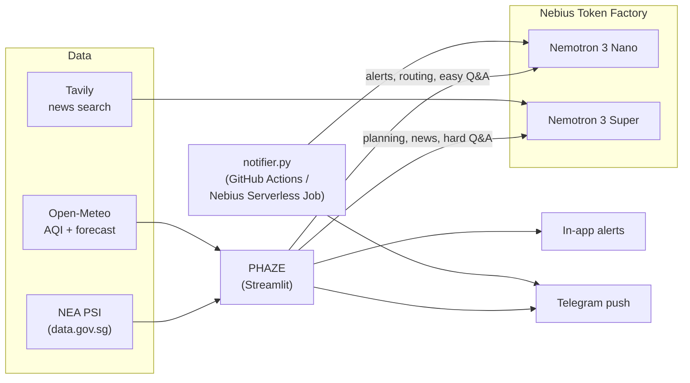

# 🌫️ PHAZE

*HAZE IS JUST A PHASE, get alerted when the air leaves the healthy range.**

Built for the **Nebius x NVIDIA Global AI Hackathon 2026** · Track: **Best Apps and Agents**
Powered by **NVIDIA Nemotron 3 (Nano + Super)** on **Nebius Token Factory**, with **Tavily** web search.

> Demo video: _add your YouTube link here_ · Live app: _add your Streamlit link here_

---

## The problem

Haze from forest and peatland fires regularly drifts across Singapore, Malaysia and Indonesia. On 20 October 2026, Singapore's official 24-hour PSI reached **141 in the west** (Unhealthy).

When that happens, people don't need another map. They need to know three things, fast:

1. **Is the air bad where I am, right now?**
2. **What should someone like me do about it?** A parent, an asthmatic and a runner need different advice.
3. **When can I go out safely, and why is this happening?**

Checking official websites by hand doesn't scale, and generic air quality apps don't explain anything. PHAZE watches the places you care about and tells you, in plain language, the moment something changes.

## What it does

| Tab | What you get |
|---|---|
| 🌍 **World map** | Live US AQI and PM2.5 for 29 haze hotspots and major cities, coloured by health level |
| 🇸🇬 **Singapore PSI** | Official 24-hour PSI from NEA for all 5 regions, with what each level means |
| 🔔 **My alerts** | A watchlist (add any city on Earth), your own limit, and instant notifications: in-app pop-ups plus optional **Telegram** push to your phone. Each alert is written by Nemotron for *your* situation (e.g. elderly, children, asthma) |
| 📈 **48-hour outlook** | A forecast chart against your limit. Nemotron Super finds the safest times for your plans (commute, exercise, kids' play) |
| 📰 **Haze news** | Tavily searches the latest news; Nemotron Super explains the causes and outlook, **with citations** |
| 💬 **Ask** | Ask anything ("Is it safe to jog tonight?"). A Nemotron Nano router decides whether Nano can answer or Super is needed |
| ⚙️ **Under the hood** | Every model call: which model, tokens, latency and cost, and how much work Nano handled |

Plus **`notifier.py`**: a background checker that sends Telegram alerts even when the app is closed (runs on GitHub Actions or as a Nebius Serverless Job).

## How it uses NVIDIA Nemotron and Nebius Token Factory

PHAZE runs entirely on **NVIDIA Nemotron 3 open models served by Nebius Token Factory**, through its OpenAI-compatible API (`phaze/llm.py`).

It uses **two Nemotron models on purpose**, routing each job to the smallest model that can do it well:

| Agent | Model | Why |
|---|---|---|
| Alert writer | **Nemotron 3 Nano** | Runs on every alert, so it must be fast and cheap |
| Question router | **Nemotron 3 Nano** | A tiny job: is this easy or hard? does it need fresh news? |
| Ask (easy questions) | **Nemotron 3 Nano** | Definitions and simple facts don't need a big model |
| Ask (hard questions) | **Nemotron 3 Super** | Multi-step reasoning about plans and trade-offs |
| Outdoor planner | **Nemotron 3 Super** | Reasons over a 48-hour forecast and the user's situation |
| Haze reporter | **Nemotron 3 Super + Tavily** | Reads several news articles and cites them accurately |

Because alerts and routing run far more often than planning, most calls go to Nano. The **Under the hood** tab shows the live split, tokens, latency and cost.

**Grounded by design.** Models never make up readings. All numbers (bands, clean-air windows, peaks) are computed in Python from official data, then handed to Nemotron to *explain*. Every agent also has a rule-based fallback, so the app keeps working if a model call fails.

### Architecture



## Run it yourself

You need Python 3.10+.

```bash
git clone https://github.com/<your-username>/PHAZE.git
cd PHAZE
python -m venv .venv
source .venv/bin/activate          # Windows: .venv\Scripts\activate
pip install -r requirements.txt
cp .env.example .env               # Windows: copy .env.example .env
```

Open `.env` and add your keys:

| Key | Where to get it | Needed? |
|---|---|---|
| `NEBIUS_API_KEY` | [Nebius Token Factory](https://tokenfactory.nebius.com) → API keys | Yes, for AI features |
| `NEMOTRON_NANO_MODEL`, `NEMOTRON_SUPER_MODEL` | Copy the exact IDs from Token Factory's model list | Defaults provided |
| `TAVILY_API_KEY` | [tavily.com](https://tavily.com) | For the news tab and web-backed answers |
| `TELEGRAM_BOT_TOKEN`, `TELEGRAM_CHAT_ID` | See below | For phone alerts |

Then:

```bash
streamlit run app.py
```

Without an API key, the app runs in **demo mode**: live air quality data still works, and alerts use rule-based text. If the air quality APIs can't be reached, it falls back to bundled sample data and says so.

### Phone alerts with Telegram (free, 2 minutes)

1. In Telegram, message **@BotFather**, send `/newbot`, and copy the token into `TELEGRAM_BOT_TOKEN`.
2. Send any message to your new bot.
3. Open `https://api.telegram.org/bot<TOKEN>/getUpdates` and copy the number after `"chat":{"id":` into `TELEGRAM_CHAT_ID`.
4. Restart the app and press **Send test notification** in the Alerts tab.

### Alerts when the app is closed

1. In the Alerts tab, press **Download watchlist.json** and put it in the project folder.
2. Run `python notifier.py` to check once, or `python notifier.py --loop 15` to check every 15 minutes.
   Use `--dry-run` to print alerts instead of sending them.

To run it in the cloud for free, push the repo to GitHub, add `NEBIUS_API_KEY`, `TELEGRAM_BOT_TOKEN` and `TELEGRAM_CHAT_ID` under **Settings → Secrets and variables → Actions**, and the included workflow (`.github/workflows/haze-alerts.yml`) checks every 30 minutes. It can also run as a **Nebius Serverless Job** with the same command.

PHAZE sends one alert per haze episode, not one every check. It alerts again only if the air gets a level worse, or after a 3-hour cooldown if it's still bad.

### Deploy the app

The easiest option is [Streamlit Community Cloud](https://share.streamlit.io): connect the GitHub repo, set the main file to `app.py`, and paste your `.env` values into **Secrets** (as `KEY = "value"` lines).

### Tests

```bash
pip install pytest
python -m pytest -q
```

The tests run offline. They cover data parsing, health bands, clean-air windows, model routing (with a fake Token Factory client), fallbacks and alert de-duplication.

## Project structure

```
app.py                  Streamlit app (7 tabs)
notifier.py             Background alert checker (CLI)
phaze/
  llm.py                Token Factory client, Nano/Super routing, usage tracking
  agents.py             Alert writer, outdoor planner, haze reporter, Ask router
  data.py               NEA PSI, Open-Meteo AQI/forecast, geocoding, offline fallbacks
  bands.py              PSI and US AQI health levels
  cities.py             Default places to track
  notify.py             Telegram push and alert de-duplication
sample_data/            Offline fallback data
tests/                  Offline test suite
```

## Data sources and credits

- **Singapore PSI**: National Environment Agency, via [data.gov.sg](https://data.gov.sg) (Singapore Open Data Licence)
- **World air quality and forecasts**: [Open-Meteo Air Quality API](https://open-meteo.com/en/docs/air-quality-api), using Copernicus Atmosphere Monitoring Service (CAMS) data. Free for non-commercial use.
- **News search**: [Tavily](https://tavily.com)
- **AI models**: NVIDIA Nemotron 3 Nano and Super, served by [Nebius Token Factory](https://nebius.com/services/token-factory)

PSI (Singapore) and US AQI (elsewhere) both treat anything above 100 as outside the healthy range, but they are calculated differently, so compare them with care.

**PHAZE is not medical advice.** Always follow official advisories, such as those from NEA in Singapore.

## License

[MIT](LICENSE)
